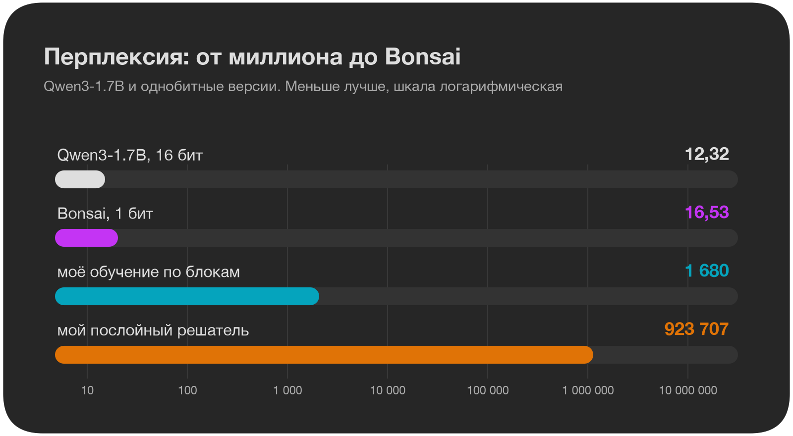
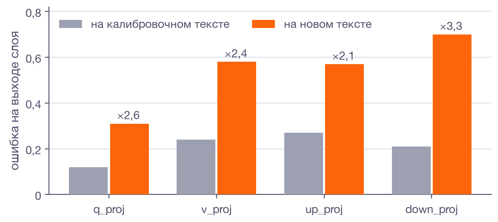
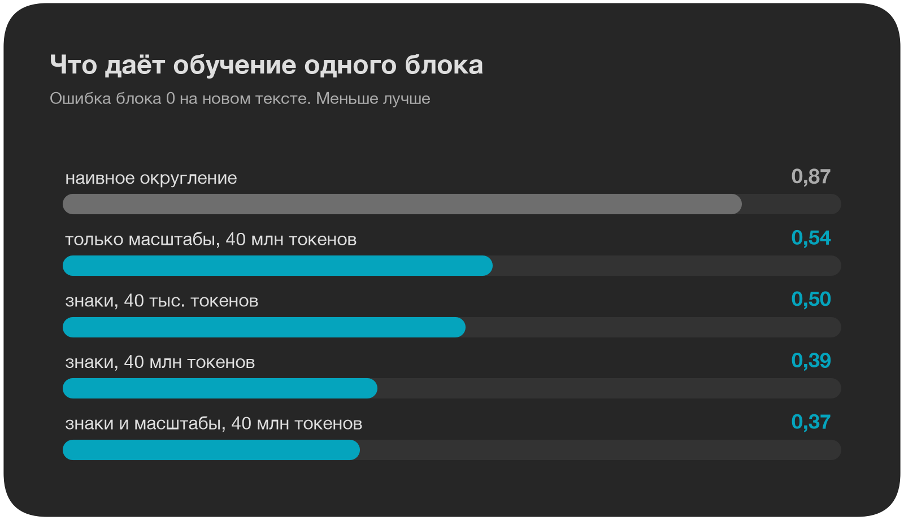
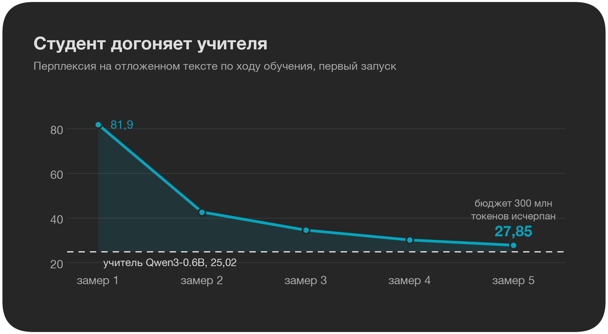
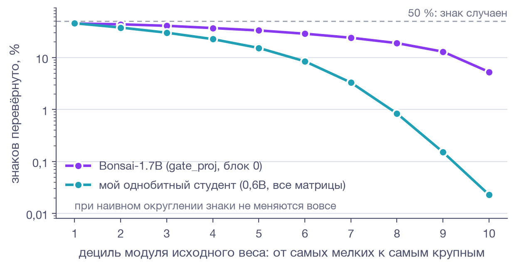
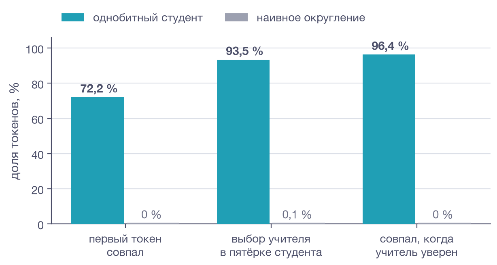
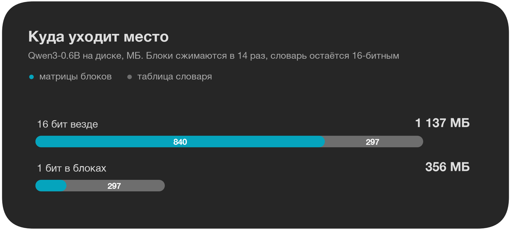

Хотели бы вы запустить большую языковую модель на видеокарте с небольшим объёмом памяти? Модель с 27 миллиардами параметров, упакованными в 16 бит, занимает около 54 ГБ. Если хранить каждый вес одним битом и один общий масштаб на группу из 128 весов, те же параметры уместятся примерно в 4 ГБ (не считая таблицы словаря).

Недостаток такого подхода: если просто округлить веса до знака, модель перестанет работать. Bonsai от PrismML использует именно такую схему хранения весов в трансформерных блоках, но при этом сохраняет работоспособность. Разработчики выложили формат, вычислительные ядра для llama.cpp и MLX, а также простой инструмент квантизации, однако не раскрыли метод получения самих весов. Я попытался воспроизвести эту процедуру. Вначале двигался по пути послойной квантизации и в результате получил нерабочую модель с большой перплексией. Затем сопоставил веса Bonsai и оригинальной Qwen3-1.7B, и это сравнение навело на мысль об использовании обучения. В итоге я самостоятельно обучил однобитную модель.



*Весь путь на одном графике. Обучение по блокам в 550 раз лучше решателя, но всё ещё в 100 раз хуже Bonsai. Шкала логарифмическая.*

<cut />

Формат «один бит на вес и один 16-битный масштаб на группу из 128 весов» даёт в среднем 1,125 бита на вес вместо исходных 16. Bonsai-1.7B с этой схемой хранения показывает перплексию 16,5, тогда как у оригинальной Qwen3-1.7B она равна 12,3.

Компанией PrismML руководит Бабак Хассиби, один из создателей метода Optimal Brain Surgeon (1992). Из этой работы выросло целое направление послойного сжатия, к которому принадлежит и GPTQ. Моей первой гипотезой стало предположение, что внутри Bonsai применяется послойный квантизатор, подобный GPTQ, но доведённый до одного бита.

Для проверки гипотезы требовалось сравнить матрицы Bonsai и оригинальной Qwen. Полные модели занимают гигабайты, а мне были нужны лишь отдельные матрицы. Я написал компактный инструмент, который сравнивает низкобитную модель с эталонной и загружает с Hugging Face только необходимые байты.

Весовые матрицы в safetensors уложены по строкам, так что первые 256 строк образуют непрерывный блок байт. Для получения статистики такого объёма хватает, и по сети передаются всего сотни килобайт.

Само по себе сравнение с оригинальными весами даёт мало информации. Поэтому инструмент всякий раз вычисляет и наивное округление: знак каждого веса и средний модуль группы в качестве масштаба. Подход можно считать осмысленным, только если он превосходит такое округление.

## Первый замер

Матрица из первого блока:

```
model.layers.0.mlp.gate_proj.weight  [256, 2048]
  cos(model, base)        +0.4886
  cos(naive binary, base) +0.7909
  sign agreement          71.0%
  scale vs mean|w|        1.990
```

Я ожидал, что веса Bonsai будут ближе к оригинальным, чем веса, полученные наивным округлением. Результат оказался противоположным: косинусное сходство Bonsai с Qwen составило 0,49, а у округления 0,79. В других слоях наблюдалась та же картина: значения от 0,41 до 0,58 у Bonsai против 0,79 у округления.

Дополнительно обнаружились два факта. Знак не совпадает для 29 % весов, тогда как округление по определению сохраняет все знаки. Масштаб группы почти вдвое превышает средний модуль весов в ней.

Такое поведение соответствовало исходной гипотезе. Послойный квантизатор наподобие GPTQ оптимизирует не близость к первоначальным весам, а ошибку на выходе слоя при прогоне калибровочных данных. Поэтому он способен отклониться от оригинальных значений сильнее, чем простое округление. Я реализовал подобный решатель для однобитного случая.

## Послойный решатель

Работа решателя устроена следующим образом. Сквозь модель пропускают несколько тысяч калибровочных токенов. На основе активаций, приходящих на вход слоя, вычисляется гессиан. После этого покоординатный спуск подбирает знаки таким образом, чтобы минимизировать ошибку на выходе слоя.

На примере первого блока (`q_proj`) ошибка выхода уменьшилась до 0,30 по сравнению с 0,55 у округления, а косинус сходства с оригиналом упал до 0,60. По обоим показателям поведение совпало с Bonsai. В течение нескольких дней я экспериментировал с масштабными коэффициентами, числом итераций и параметрами регуляризации, после чего собрал из обработанных таким образом слоёв целую модель:

| модель | перплексия |
|---|---|
| Qwen3-1.7B, fp16 | 12,32 |
| Bonsai, 1 бит | 16,53 |
| послойный решатель | 923 707 |

Причина вскрылась, когда я проверил те же слои на тексте, не входившем в калибровочную выборку:



*На новом тексте ошибка каждого слоя в 2–3 раза выше, чем на калибровке. Решатель запомнил калибровку.*

<spoiler title="Таблица с обусловленностью гессиана">

| слой | ошибка на калибровке | ошибка на новом тексте | обусловленность гессиана |
|---|---|---|---|
| q_proj | 0,12 | 0,31 | 4,7·10¹² |
| v_proj | 0,24 | 0,58 | 4,7·10¹² |
| up_proj | 0,27 | 0,57 | 1,6·10¹³ |
| down_proj | 0,21 | 0,70 | 4,5·10⁷ |

</spoiler>

Восьми тысяч токенов недостаточно для точного определения гессиана размерности 2048 или 6144. В нём остаются направления с почти нулевой кривизной, и решатель уводит веса именно в эти направления. На калибровочных данных это не наказывается, а на постороннем тексте ошибка возрастает в два-три раза. Попытка применить регуляризацию с коэффициентом 1 % от среднего собственного числа не помогла: почти весь след гессиана обусловлен несколькими признаками с выбросами.

После этого я прекратил доводку решателя и вместо этого детальнее сопоставил веса Bonsai и Qwen.

## Что показывают веса Bonsai

В ходе анализа весов Bonsai я выделил пять ключевых свойств.

1. Каждая из 196 матриц использует однобитное представление. Для группы в 128 весов хранится одно значение масштаба; нулевых или высокоточных элементов нет. Таблица эмбеддингов также однобитная.
2. Эмбеддинги получены простым округлением весов Qwen. Совпадение знаков достигает 99,93 %, масштаб составляет `mean|w|`. Это указывает, что Bonsai основана на Qwen3-1.7B, а расхождения в матрицах блоков вносились целенаправленно.
3. Доля инвертированных знаков меняется в зависимости от величины параметра. В блоках расхождение знаков составляет от 21 до 36 %. Для самых малых весов инвертировано 48 %, для самых больших 5,6 %. Такая зависимость характерна для градиентного спуска, стартующего от знаков исходной модели: небольшой градиент легко перебрасывает малый вес через ноль, тогда как для переворота крупного требуется значительно большее воздействие. У разработанного мной послойного решателя профиль был почти плоским, и крупные веса переворачивались почти с той же частотой, что и мелкие.
4. Внутренние состояния двух моделей заметно отличаются, но предсказания остаются близкими. Для второго блока косинусное сходство скрытых состояний Bonsai и Qwen составляет 0,10. Тем не менее, наиболее вероятный следующий токен совпадает в 70 % случаев, а среднее KL-расхождение равно 0,55. Внутренние представления с Qwen не согласовывали, согласовывали выходное распределение.
5. Конфигурация Bonsai не совпадает с Qwen3-1.7B. В ней активирован метод YaRN, увеличивающий длину контекста с 8192 до 32768 токенов, а словарь уменьшен до 151 669 токенов. В исходной Qwen3-1.7B такие изменения отсутствуют.

Эти пять свойств укладываются в единую картину: Bonsai получили путём дообучения с однобитными весами, стартовав от знаков Qwen. Матрицы Bonsai не приближают матрицы Qwen. Послойный квантизатор, который стремится минимизировать расхождение с исходными матрицами, такую сеть построить не способен. Этот вывод основан только на анализе весов: кода PrismML я не видел.

> Bonsai не квантизовали, а обучали. Её матрицы не приближают матрицы Qwen: это другая сеть, которая считает ту же функцию.

## Обучение знаков по блокам

После анализа я перешёл к экспериментам с обучением. Способ параметризации остался прежним: при умножении используется знак веса и масштаб группы, а сам вес сохраняется в полной точности и обновляется градиентами. Градиент через функцию знака проходит с помощью прямого оценщика (straight-through estimator): на обратном проходе функция знака заменяется тождественным отображением.

Первые опыты я проводил на ноутбуке, обучая по одному блоку. На вход блока подавались данные, прошедшие через уже бинаризованные предшествующие слои, а в качестве целевого значения использовался выход полноточной модели. Результат для блока 0:

| вариант | ошибка блока | перплексия всей модели |
|---|---|---|
| наивное округление | 0,86 | 484 621 |
| послойный решатель | 0,72 | 5 525 |
| обучение, 46 секунд | 0,56 | 345 |

Профиль инвертированных знаков после обучения напоминает картину, полученную для Bonsai: 44 % для малых весов и 0,2 % для больших.

Далее на том же блоке я сравнил несколько вариантов, каждый из которых стартовал от исходных весов:



*Больше всего ошибку снижает объём данных, обучаемый масштаб добавляет ещё немного.*

<spoiler title="Таблица">

| вариант | ошибка блока |
|---|---|
| наивное округление | 0,87 |
| знаки, 40 тыс. токенов | 0,50 |
| знаки, 40 млн токенов | 0,39 |
| знаки и масштабы, 40 млн токенов | 0,37 |
| только масштабы, 40 млн токенов | 0,54 |

</spoiler>

Наибольший вклад вносит количество данных. Обучаемый масштаб также улучшает результат. Это согласуется с тем, что масштаб Bonsai оказался вдвое выше среднего модуля весов. Вероятно, его не вычисляли по фиксированной формуле, а получали в ходе обучения.

Последовательное обучение всех 28 блоков привело к перплексии 1 680. Это в 550 раз лучше результата решателя, но примерно в 100 раз хуже, чем у Bonsai. Поблочное обучение наталкивается на принципиальный предел. Каждый следующий блок компенсирует ошибки, пришедшие от предыдущих, но не учитывает, как его собственный выход будет использоваться дальше. Ошибка растёт с глубиной: 0,20 на блоке 3 и 0,52 на блоке 23, и даже тщательная подгонка отдельных блоков эту тенденцию не ломает.

Проблему накопления ошибки решает обучение по полному выходу сети, когда в графе вычислений участвует вся модель целиком. Это классическая дистилляция: однобитный студент учится воспроизводить распределение следующего токена, предсказываемое полноточным учителем. Для модели размером 1,7B и 10 млрд токенов я оцениваю время примерно в сутки на двенадцати ускорителях A100, так что на ноутбуке такой эксперимент уже не провести.

## Дистилляция на одной видеокарте

Для дистилляции я подготовил второй проект. В нём все матрицы внутри блоков заменяются однобитными и оптимизируются по выходу исходной модели, которая на каждом шаге вычисляет целевое распределение. Эмбеддинги, выходной слой и слои нормализации сохраняются в полной точности.

Первый запуск: учитель Qwen3-0.6B, 300 миллионов токенов из набора FineWeb-Edu, одна видеокарта, время работы около 15 часов.

| модель | перплексия | совпадение первого токена с учителем |
|---|---|---|
| учитель | 25,02 | – |
| однобитный студент | 27,85 | 0,70 |
| наивное округление тех же 196 матриц | 6 877 887 | – |

Перплексия студента оказалась на 11 % выше, чем у учителя. Кривая потерь к концу обучения всё ещё снижалась (значения: 81,9; 42,7; 34,6; 30,2; 27,85), так что разрыв определяется выделенным бюджетом в 300 миллионов токенов, а не пределом возможностей метода.



*Студент всё ещё улучшается, когда бюджет в 300 млн токенов заканчивается.*

Распределение инвертированных знаков у студента по децилям абсолютной величины веса (от меньших к большим) выглядит так: 45,8; 37,8; 30,1; 22,7; 15,3; 8,5; 3,3; 0,8; 0,2 и 0,02 %. Форма кривой такая же, как у Bonsai. Косинусное сходство с исходными весами составило 0,67 против 0,79 у простого округления: обученная модель снова дальше от оригинальных весов, чем результат наивного округления, и при этом работает.



*Мелкие веса меняют знак часто, крупные почти никогда. Такой профиль у обеих обученных моделей. Шкала логарифмическая.*

Второй запуск выполнялся на двух ускорителях A100 с использованием смеси доменов olmo-mix-1124 и объёмом 700 миллионов токенов:

| модель | перплексия | первый токен совпал | выбор учителя в топ-5 студента | совпал, когда учитель уверен |
|---|---|---|---|---|
| учитель | 11,72 | 1,000 | 1,000 | 1,000 |
| наивное округление | 3 645 563 | 0,000 | 0,001 | 0,000 |
| студент | 15,73 | 0,722 | 0,935 | 0,964 |

Последний столбец рассчитан по токенам, для которых учитель назначает собственному выбору вероятность не менее 0,9. Таких позиций 30 %, и в этих случаях студент воспроизводит выбор учителя в 96,4 % ситуаций. Большая часть расхождений возникает там, где учитель сам распределяет вероятность между несколькими вариантами.



*Наивное округление почти никогда не угадывает выбор учителя. Однобитный студент угадывает его в 72 % случаев, а там, где учитель уверен, в 96 %.*

### Размер и скорость

Матрицы блоков уменьшаются в 14,2 раза. Однако у модели Qwen3-0.6B словарь из 151 936 токенов содержит 156 миллионов параметров из общих 596 миллионов, и эта таблица сохраняется в 16-битном формате. Поэтому полный размер модели сокращается с 1137 до 356 МБ, то есть в 3,2 раза. Для более крупных моделей доля словаря ниже, и степень сжатия должна приближаться к 14-кратной, но эти расчёты я не проверял.



*Матрицы блоков сжимаются в 14 раз, но таблица словаря остаётся в 16 битах и занимает большую часть файла.*

Скорость генерации осталась прежней: 37,2 токена в секунду для обеих версий. Поскольку специализированного ядра для работы с упакованными битами у меня нет, на этапе вывода матрицы разворачиваются в bfloat16. Выигрыш пока ограничивается размером файла на диске.

## Как по весам отличить обучение от квантизации

В результате сложился практический метод диагностики. Если сравнить исходную модель с её низкоразрядной версией и посчитать долю инвертированных знаков для каждого дециля абсолютной величины исходного веса, форма этой кривой показывает, как получена модель:

- Знаки не изменены: простое округление.
- Переворотов много, но их частота почти не зависит от величины веса: вероятно, работал послойный решатель.
- Малые веса переворачиваются часто, а крупные почти никогда: модель дообучали.

Для такого анализа не требуются ни данные, ни запуск модели. Тот же профиль помогает и при собственных экспериментах: если частота переворотов не снижается с ростом величины веса, это говорит о том, что обучение не движется в нужном направлении, даже если потери формально уменьшаются.
